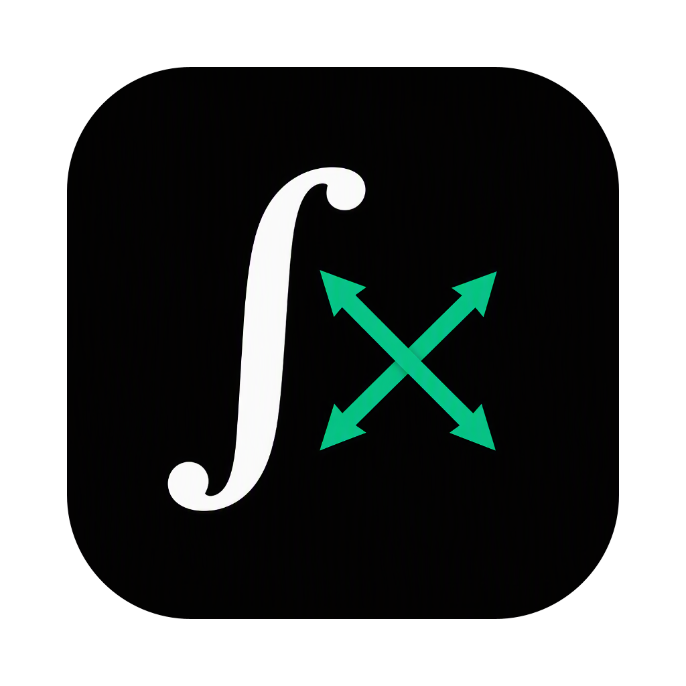

<p align="center">
  
</p>

<h1 align="center">Callista</h1>

<p align="center">Calculadora educativa de <b>Cálculo II</b> que resuelve y <b>explica paso a paso</b>.</p>

Proyecto de los cursos **Programación II** y **Cálculo II**. Callista no solo da el
resultado: muestra el procedimiento (qué regla o técnica se aplicó en cada paso), la
gráfica y, en volúmenes, el sólido en 3D. Todo el cálculo simbólico lo hace un motor
matemático propio, sin librerías externas de álgebra.

## Qué puede hacer

| Operación | Detalle |
|---|---|
| **Evaluar función** | Valor de f(x) en un punto. |
| **Derivada** | Orden 1 a 3 con pasos (reglas básicas, producto, cociente, cadena), evaluación en un punto y recta tangente. |
| **Integral indefinida** | Inmediatas, sustitución, integración por partes (repetida y cíclica) y desarrollo algebraico; el resultado se comprueba derivando. |
| **Integral definida** | Exacta con el Teorema Fundamental del Cálculo, numérica (trapecio, Simpson, punto medio) y comparación entre ambas. Detecta y resuelve **integrales impropias** (converge o diverge) con límites y L'Hôpital. |
| **Área entre curvas** | Puntos de corte, región encerrada o en [a, b], división en tramos. |
| **Volumen de sólido de revolución** | Discos, arandelas o capas según el eje (x, y, y = k, x = k), con vista 3D del sólido. |

Las expresiones se escriben en texto plano: `3*x^2 + sin(x)`, `e^x * ln(x)`, `sqrt(1 - x^2)`.
Se acepta multiplicación implícita (`2x`) y nombres en español (`sen`, `raiz`…).

## Descargar y ejecutar

### Como programa (recomendado)

Callista se puede instalar como cualquier programa, con su icono y **sin necesidad de
tener Java instalado**. Para crear el instalador:

```bash
./gradlew jpackage      # .dmg en macOS, .exe en Windows → build/jpackage/
```

Requisitos, instalación y detalles en **[packaging/README.md](packaging/README.md)**.

### Desde el código

Requiere **JDK 25**. Gradle no hace falta: el proyecto trae su *wrapper*.

```bash
./gradlew run           # ejecutar
./gradlew test          # pruebas
```

En Windows se usa `gradlew.bat` en lugar de `./gradlew`.

**En IntelliJ IDEA:** *File → Open…* → seleccionar `build.gradle` → *Open as Project*.
Los formularios (`.form`) se editan con el GUI Designer de IntelliJ.

## Tecnologías

- **Java 25** y **Swing**, con formularios del **IntelliJ GUI Designer**.
- **[FlatLaf](https://www.formdev.com/flatlaf/)** para la apariencia (paleta pastel morado/magenta o gris formal).
- **Gradle** para compilar, probar y empaquetar (`jpackage`).
- **JUnit 6** para las pruebas.

## Estructura

Arquitectura **MVC** (Modelo – Vista – Controlador):

```
src/main/java/com/callista/
├── Main.java          # punto de entrada
├── model/             # motor matemático (no depende de la interfaz)
│   ├── expression/    # árbol de expresiones y simplificador
│   ├── parser/        # texto → árbol, con mensajes de error
│   ├── calculus/      # derivadas, integrales, límites, área, volúmenes, métodos numéricos
│   └── graph/         # muestreo y escalas para graficar
├── view/              # ventana, paneles, gráfica 2D, sólido 3D, procedimiento
└── controller/        # une vista y modelo; un controlador por operación
src/main/resources/icon/   # icono de la aplicación
packaging/                 # ejecutable: íconos e instrucciones
```

- **`model`** no conoce Swing: recibe expresiones y devuelve un resultado con resumen,
  pasos del procedimiento y gráfica.
- **`view`** solo muestra; no contiene matemática.
- **`controller`** lee lo que escribió el usuario, llama al modelo y muestra el resultado.

## Estado

Hecho: evaluación, derivadas, integrales (indefinidas, definidas, numéricas e impropias),
área entre curvas y volúmenes de revolución.

En desarrollo: volúmenes por secciones transversales y los temas de varias variables
(derivadas parciales, vectores, rectas y planos, coordenadas esféricas).
